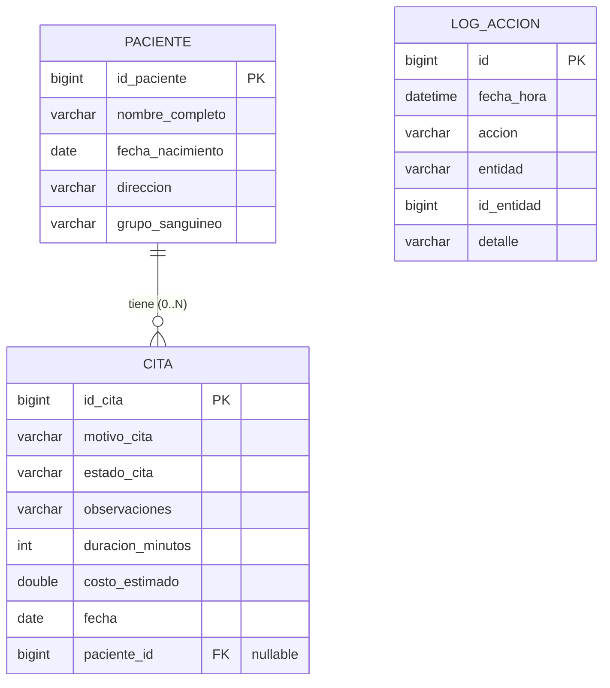

# Clínica DAW – Gestión de pacientes y citas

Aplicación web desarrollada con **Spring Boot**, **Spring Data JPA** y **Thymeleaf** (con Bootstrap 5) para gestionar los pacientes de una clínica y sus citas médicas.

## 1. Descripción del proyecto y temática

**Temática:** gestión sanitaria básica. Una clínica necesita registrar a sus pacientes y llevar el control de las citas de cada uno (motivo, fecha, estado, duración y coste estimado).

Se trabaja con dos entidades relacionadas 1:N:

| Entidad | Rol | Descripción |
|---|---|---|
| **Paciente** | Principal | Datos personales: nombre, fecha de nacimiento, dirección y grupo sanguíneo. |
| **Cita** | Secundaria | Cita médica. Puede estar asociada a un paciente o quedar sin asignar. |
| **LogAccion** | Auxiliar | Registro de las altas, modificaciones y borrados realizados en la aplicación. |

Un paciente puede tener muchas citas; una cita pertenece, como máximo, a un paciente. La relación es opcional para poder asociar y desasociar citas.

## 2. Diagrama ER



- `CITA.paciente_id` es la clave foránea hacia `PACIENTE`. Admite `NULL` (cita sin paciente).
- `LOG_ACCION` no tiene claves foráneas: guarda el nombre de la entidad y su id como texto/valor para conservar el historial aunque el elemento se borre.
- Al eliminar un paciente, sus citas **no se borran**: pasan a quedar sin paciente.

## 3. Instalación y ejecución

### Requisitos

- **Java 17** o superior
- **Maven 3.8+** (o usar el IDE: VS Code, IntelliJ, Eclipse/STS)
- Conexión a Internet (Bootstrap y los iconos se cargan desde CDN)

### Pasos

```bash
# 1. Descomprimir el proyecto y entrar en la carpeta
cd crudapi

# 2. Arrancar la aplicación
mvn spring-boot:run
```

Después abre en el navegador: <http://localhost:8080>

Para generar un `.jar` ejecutable:

```bash
mvn clean package
java -jar target/crudapi-0.0.1-SNAPSHOT.jar
```

### Base de datos

Por defecto se usa **H2 en fichero** (se crea sola en `./data/clinica`), por lo que no hace falta instalar nada. Las tablas se generan automáticamente (`ddl-auto=update`).

- **Datos de ejemplo:** la primera vez que arranca con la base vacía se cargan 5 pacientes y 10 citas.
- **Consola H2:** <http://localhost:8080/h2-console> con la URL `jdbc:h2:file:./data/clinica`, usuario `sa` y contraseña vacía.
- **Reiniciar los datos:** parar la aplicación y borrar la carpeta `data/`.

#### Usar MySQL en lugar de H2

1. En `pom.xml`, sustituir la dependencia `h2` por `mysql-connector-j`.
2. En `src/main/resources/application.properties`, comentar el bloque de H2 y descomentar el de MySQL (ajustando usuario y contraseña).

## 4. Funcionalidades implementadas

### Estructura de navegación

- Menú superior Bootstrap con logo/nombre del proyecto y enlaces a Pacientes, Citas, Búsqueda avanzada, Estadísticas y Logs, además del enlace de inicio.
- Menú y mensajes reutilizables mediante fragmentos Thymeleaf (`fragments/menu.html`).

### CRUD de Pacientes (entidad principal) – `/pacientes`

| Método | Ruta | Función |
|---|---|---|
| GET | `/pacientes?page=0&size=5` | Listado paginado (página y elementos por página) |
| GET | `/pacientes/nuevo` | Formulario de creación |
| POST | `/pacientes/crear` | Procesar creación |
| GET | `/pacientes/editar/{id}` | Formulario de edición |
| POST | `/pacientes/modificar` | Procesar modificación |
| GET | `/pacientes/eliminar/{id}` | Eliminar (con modal de confirmación) |
| GET | `/pacientes/detalle/{id}` | Vista detallada especial |

**Vista detallada:** al pulsar el nombre de un paciente se muestran, arriba, todos sus datos y, abajo, una tabla con **solo sus citas**. Desde ahí se puede añadir una cita nueva ya asociada al paciente, y editar, desasociar o eliminar cada cita; después de cada acción se vuelve al detalle.

### CRUD de Citas (entidad secundaria) – `/citas`

- Listado paginado, alta, edición y borrado con modal de confirmación (`/citas`, `/citas/nuevo`, `/citas/crear`, `/citas/editar/{id}`, `/citas/modificar`, `/citas/eliminar/{id}`).
- **Asociar / desasociar** una cita a un paciente (`POST /citas/asociar/{id}` y `POST /citas/desasociar/{id}`), tanto desde el listado de citas como desde el detalle del paciente.
- **Limpieza masiva** (con confirmación):
  - Eliminar citas *Canceladas* anteriores a una fecha.
  - Eliminar citas *sin paciente* con un estado concreto.

### Repositorios (Spring Data JPA)

**`PacienteRepository`**

| Requisito | Método |
|---|---|
| Búsqueda con varias condiciones | `findByGrupoSanguineoAndNombreCompletoContainingIgnoreCase` |
| Búsqueda con varias condiciones | `findByFechaNacimientoBetweenAndDireccionContainingIgnoreCase` |
| Ordenación | `findAllByOrderByNombreCompletoAsc` |
| Conteo | `countByGrupoSanguineo` |
| Top / agregación | `findTop5ByOrderByFechaNacimientoAsc` y `contarPacientesPorGrupo` (`@Query` con `group by`) |
| `@Query` JPQL con parámetro | `findConAlMenosCitas(minCitas)` |

**`CitaRepository`**

| Requisito | Método |
|---|---|
| Borrado por condición | `deleteByEstadoCitaAndFechaBefore` |
| Borrado por condición | `deleteByPacienteIsNullAndEstadoCita` |
| Búsqueda con filtros | `findByEstadoCitaContainingIgnoreCaseAndFechaBetweenAndCostoEstimadoGreaterThanEqualOrderByFechaDesc` |
| `@Query` personalizada | `findMasCarasQueLaMedia(estado)` |

Además hay consultas auxiliares para estadísticas (`contarPorEstado`, `costeMedio`, `costeTotal`, `duracionMedia`), para el detalle del paciente (`findByPaciente_IdPacienteOrderByFechaDesc`) y para desasociar las citas al borrar un paciente (`desasociarDePaciente`).

### Funcionalidades avanzadas

- **Búsqueda avanzada** (`/busqueda`): un formulario por cada método de búsqueda de los repositorios (por grupo y nombre, por rango de nacimiento y dirección, pacientes con N citas, citas con filtros, citas más caras que la media).
- **Gestión de logs** (`/logs`): se registra cada creación, modificación y borrado (incluidos asociar/desasociar y borrados masivos) con fecha y hora, acción, entidad, id y detalle. Listado paginado, del más reciente al más antiguo.
- **Estadísticas** (`/estadisticas`): totales, coste medio y total, duración media, pacientes por grupo sanguíneo, citas por estado, los 5 pacientes de más edad, pacientes con al menos N citas y conteo por grupo sanguíneo elegido.
- **Exportación** del listado de pacientes a **CSV** (`/pacientes/exportar/csv`, compatible con Excel) y a **PDF** (`/pacientes/exportar/pdf`).
- **Confirmación de eliminación** mediante modal de Bootstrap, reutilizable para enlaces (borrado individual) y formularios (borrados masivos).
- **Validación de formularios** con Bean Validation y mensajes de error en cada campo.

### No implementado

- Perfil de usuario y autenticación con OAuth (Google/Facebook), por ser opcional.

## 5. Estructura del proyecto

```
src/main/java/com/daw/crudapi/
├── CrudapiApplication.java
├── DataLoader.java                  Datos de ejemplo
├── model/                           Paciente, Cita, LogAccion
├── repository/                      PacienteRepository, CitaRepository, LogAccionRepository
├── service/                         LogService
└── controller/                      Home, Paciente, Cita, Busqueda, Estadisticas, Log

src/main/resources/
├── application.properties
└── templates/
    ├── fragments/menu.html
    ├── pacientes/                   lista, detalle, nuevo, editar
    ├── citas/                       lista, nuevo, editar
    └── index, busqueda, estadisticas, logs
```

## 6. Tecnologías

Spring Boot 3.3 · Spring Data JPA (Hibernate) · Thymeleaf · Bootstrap 5.3 y Bootstrap Icons · H2 / MySQL · Lombok · OpenPDF · Maven · Java 17
